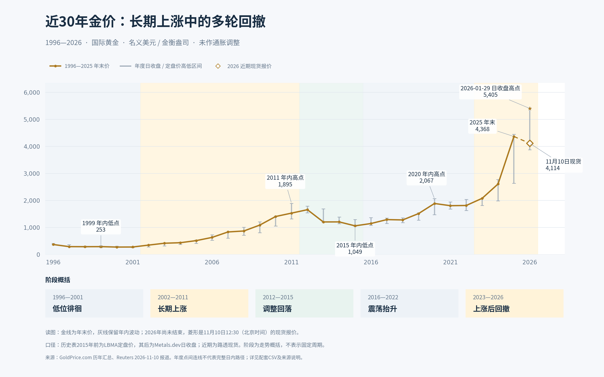

# 近30年国际金价周期图（1996—2026）



## 图表口径

- 单位：名义美元/金衡盎司，未作通胀调整，不是人民币金价或金店首饰售价。
- 1996—2025年金色折线：逐年年末最后一笔收盘价；灰色竖线：该年日收盘/定盘价序列的高低区间，不是盘中最高最低价。
- 历史汇总表说明：2015年之前使用LBMA定盘价，之后接续Metals.dev日收盘价，历史口径存在变更。
- 2026年灰线为来源页面查询时已提供的年内区间，不能视为全年数据。2026年年末收盘价留空，没有预测或填造。
- 2026年菱形：Reuters报道的2026年11月10日04:30 UTC（北京时间12:30）国际现货报价4,114.48美元/盎司，与历史收盘序列口径有差别。
- 2026年1月29日5,405美元为GoldPrice.com序列内的日收盘高点，不是盘中历史最高成交价。
- 年份横轴用于年度汇总；连线不代表两点之间的实际每日行情。
- 阶段文字是作者为便于读图作的概括，不是官方周期划分，也不表示黄金有固定长度的周期。

## 数据来源

1. [GoldPrice.com 历年黄金价格汇总](https://www.goldprice.com/gold-price-history)：1996—2025年年末价、1996—2026年日收盘/定盘价年度高低值，以及2026年1月29日日收盘高点。查询日期：2026年11月10日。
2. [Reuters：Gold edges lower as focus shifts to US inflation data](https://www.reuters.com/world/india/gold-edges-lower-focus-shifts-us-inflation-data-2026-11-10/)：2026年11月10日04:30 UTC现货报价，来自该报道的检索摘要。

## 文件与复现

- `gold_annual_prices_1996_2026.csv`：年度价格数据，2026年标为partial_year，year_end_close留空。
- `gold_recent_quote.csv`：近期报价和精确时点。
- `gold_cycle_1996_2026.png` / `.pdf` / `.svg`：图表导出文件。
- `draw_gold_cycle.py`：生成图表与CSV。依赖Python、matplotlib及Noto Sans CJK字体；其他系统请调整脚本内的字体路径。

```bash
python draw_gold_cycle.py
```

数据为公开来源的转录汇总，整理日期：2026年11月10日。
