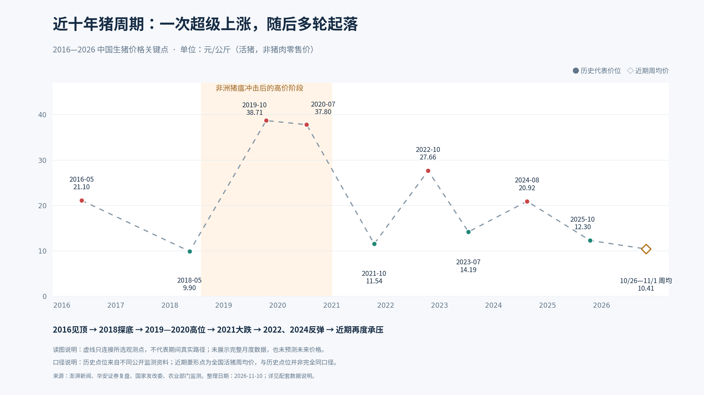

# 中国猪周期图（2016—2026）



本图展示历史代表性价格点，不是完整月度行情。虚线仅用于连接观测点，不代表期间真实价格路径，也未预测未来价格。不同资料采用的监测口径不完全一致；价格单位均为元/公斤，指生猪（活猪）价格。

## 文件

- [PNG 图表](pig_cycle_2016_2026.png)
- [PDF 高清版](pig_cycle_2016_2026.pdf)
- [SVG 矢量版](pig_cycle_2016_2026.svg)
- [CSV 原始观测点及来源链接](pig_cycle_reference_points.csv)
- [数据口径与来源说明](数据说明.md)
- [绘图脚本](draw_pig_cycle.py)

## 重新生成

依赖 Python 和 matplotlib，以及 Noto Sans CJK 中文字体。脚本默认使用 Linux 字体路径，其他系统请相应修改字体路径。

```bash
python draw_pig_cycle.py
```

图表及配套文件输出到脚本所在目录。整理日期：2026年11月10日；最近监测区间：2026年10月26日至11月1日。
